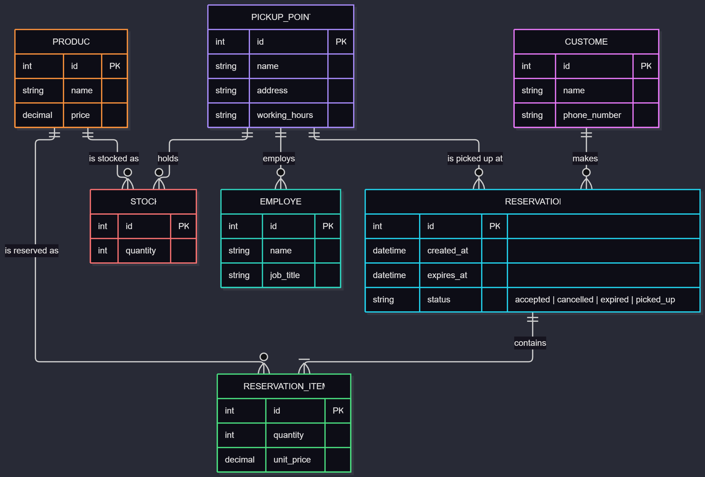

# Онлайн-магазин з бронюванням (click & reserve) — ER-модель

## Домен
Магазин працює тільки на бронь товару, наявного на точках видачі. Клієнт робить бронь товару, та забирає його з пунктів видачі. Використовує систему і клієнт для бронювання товару, і робітник для його видачі. Цей домен підходить під вимоги лабораторної, в ньому з'являються потрібні зв'язки багато-до-багатьох з атрибутами, а процес броні знадобиться для наступних лабораторних, тому саме цей варіант я і обрала

## Структура репозиторію
- `spec.md` — специфікація: сутності, атрибути, зв'язки, критерії прийняття
- `model/er.mmd` — ER-модель у Mermaid `erDiagram`
- `model/er.png` — рендер ER-діаграми
- `audit/er-audit.md` — аудит: розбіжності spec ↔ модель, топ-3 виправлення
- `adr/` — записи архітектурних рішень (MADR)
- `ai/ai-work-log.md` — повний слід роботи з AI
- `DEFENSE.md` — точка входу для рев'ю

## Діаграма
