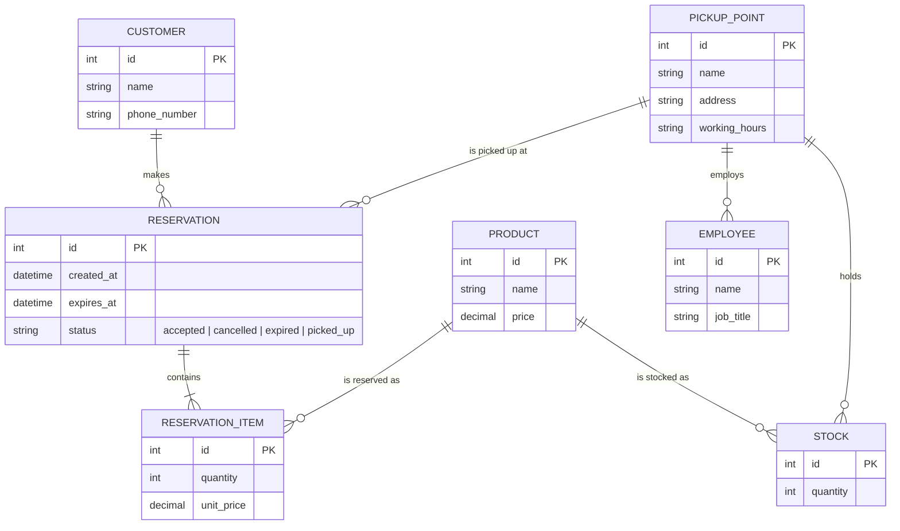

# AI work log — Lab 1 (ER model)
## Prompt 1 — spec review

**Мій запит:**
````markdown
# Специфікація — Онлайн-магазин з бронюванням (click & reserve)

## Намір
Система бронює товар для самовивозу для кліенту 

## Сутності та атрибути
Клієнт- ім'я, номер телефону
Товар- назва, ціна
Бронь- дата бронювання, кінець сроку бронювання. Це окрема бронь на кожного окремого клієнта
Точка видачі- наявність кожного товару на заданій точці видачі

## Зв'язки
Один клієнт може мати багато броней. Один товар на одну людину

## Критерії прийняття
Всі id одного типу
Ціна храниться в типі товару, а не копіюється в кожний товар
````
**Відповідь AI:**

### Головні прогалини (впливають на схему)

**1. «Один товар на одну людину» — незрозуміло, що це означає.**
- Чи можна в одній броні забронювати **кілька різних** товарів?
- Чи можна забронювати **кілька штук** одного товару?
Якщо хоча б на одне питання відповідь «так» — між бронню й товаром
зв'язок «багато-до-багатьох» з кількістю, і потрібна окрема сутність
посередині (напр. «позиція броні»), бо зв'язок має власні атрибути.

**2. «Наявність кожного товару» — це не атрибут точки видачі.**
Наявність залежить одразу від двох речей: який товар і на якій точці.
- Чи може один товар бути на кількох точках?
- Чи може на одній точці бути багато товарів?
- Де тоді зберігається кількість «скільки штук товару X на точці Y»?
- Які атрибути має сама точка (адреса, назва, години роботи)?

**3. Бронь не пов'язана з точкою видачі.**
Де клієнт забирає бронь? Одна бронь — одна точка чи може бути кілька?

**4. У броні немає статусу.**
Як зрозуміти, що бронь забрали, скасували чи вона прострочена?
Які статуси бувають?

**5. Ціна.** Критерій «ціна зберігається в типі товару» не підходить —
сутності «тип товару» немає. Реальне питання:
- якщо товар подорожчав після бронювання, клієнт платить **стару**
  ціну чи **нову**?
Якщо стару — ціну на момент броні треба десь зберігати, і це
свідомий виняток, який варто описати.

### Дрібніше

**6. Зв'язки описані в один бік і не всі.** Для кожної пари — в обидва
боки («один клієнт — багато броней; одна бронь — рівно один клієнт»).
Бракує зв'язків: товар–бронь, товар–точка, бронь–точка.

**7. Намір.** Хто користується системою — лише клієнт чи ще працівник
точки, який видає товар? Від цього залежить, чи потрібна сутність
«працівник».

**8. Критерії прийняття.** Варто розглянути:
- якого **саме** типу всі id (число чи рядок);
- модель у 3NF;
- немає сполучних таблиць без атрибутів; M:N з атрибутами —
  асоціативна сутність;
- назви атрибутів у spec і на схемі збігаються (одразу дописати
  англійські назви: «ціна (`price`)»).

**9. Описки:** «кліенту» → «клієнта», «срок» → «строк/термін»,
«храниться» → «зберігається».

## Мої рішення

**1.** Так, в одній броні може бути кілька різних товарів, також декілька штук однакового товару => додаю сутність "позиція броні"

**2.**
- Чи може один товар бути на кількох точках?  Так
- Чи може на одній точці бути багато товарів? Так
- Де тоді зберігається кількість «скільки штук товару X на точці Y»? Додаю та зберігаю наявність товарів в сутності "залишок на точці"
- Які атрибути має сама точка (адреса, назва, години роботи)? Адреса, назва, години роботи

Додаю атрибути точки видачі(адреса, назва, години роботи), також додаю сутність "залишок на точці" з атрибутом кількість

**3.** Одна бронь з конкретними товарами відноситься до точки видачі, на якій є ці товари.Одна точка видачі-багато броней

**4.** Додаю до броні статуси
Прийнято, скасовано, прострочено, товар забрали

**5.** Критерій ціна зберігається в самому конкретному товарі. Категорію товару не додаю, на конкретні моделі з категорії різна ціна. Ціну на момент броні зберігаю в "позиція броні"

**6.** Додаю більше зв'язків типів товар–бронь, товар–точка, бронь–точка. Також додаю зв'язки в обидві сторони

**7.** Системою користується і клієнт, і робітник. Дописую наміри. Також додаю робітника в сутності зі своїми атрибутами(ім'я, посада). В зв'язках записую робітник-точка видачі на якій він працює

**8.**  Додаю критерії прийняття:
- id всіх сутностей одного типу — integer;
- модель у 3NF, щоб кожен факт зберігався в одному місці;
- чистий M:N малюю як зв'язок, без сполучних таблиць; якщо зв'язок
  має власні атрибути — роблю асоціативну сутність
  (позиція броні, залишок на точці);
- назви атрибутів у spec і на схемі збігаються.(додаю англійські назви в дужках в spec.md)

## Prompt 2 — spec check against decisions

**Мій запит:** перевір, чи виконала я в spec.md всі умови, які записала
в «Мої рішення». 
````markdown
# Специфікація — Онлайн-магазин з бронюванням (click & reserve)

## Намір
Система бронює товар для самовивозу для кліенту. Зберігає для робітника дані про клієнта

## Сутності та атрибути
**Клієнт**- ім'я(`name`), номер телефону(`phone_number`)
**Робітник**- ім'я(`name`), посада(`job_title`)
**Товар**- назва(`name`), ціна(`price`)
**Бронь**- дата бронювання (`created_at`), кінець строку (`expires_at`), статус (`status`) 
 Можливі значення `status`:
  - `accepted` — прийнято;
  - `cancelled` — скасовано; 
  - `expired` — прострочено;
  - `picked_up` — товар забрали.
**Позиція броні**- кількість(`quantity`), ціна на момент броні(`unit_price`)
**Точка видачі**- адреса(`address`), назва(`name`), години роботи(`time_work`)
**Залишок на точці**- кількість товару(`quantity`)

## Зв'язки
Один клієнт може мати багато броней, одну бронь з декількома різними або однаковими товарами. Це все пов'язано між клієнт-бронь, бронь-позиція броні.
Одна бронь з конкретними товарами відноситься до точки видачі, на якій є ці товари. Одна точка видачі- багато броней.
Позиція належить рівно одній броні, в броні одна або багато позицій.
Позиція стосується рівно одного товару, товар може бути в багатьох позиціях.
Один робітник працює на одній точкі видачі, на точці видачі декілька робітників.


## Критерії прийняття
- id всіх сутностей одного типу — integer;
- модель у 3NF, щоб кожен факт зберігався в одному місці;
- чистий M:N малюю як зв'язок, без сполучних таблиць; якщо зв'язок
  має власні атрибути — роблю асоціативну сутність
  (позиція броні, залишок на точці);
- назви атрибутів у spec і на схемі збігаються.                                        
````

**Відповідь AI:**

### Бракує (з моїх рішень)

**1. Зв'язки «залишку на точці» не описані** (рішення 2 і 6).
Сутність є, а з чим вона пов'язана — ні. Потрібно:
- залишок стосується рівно одного товару; товар може мати багато
  залишків (на різних точках);
- залишок належить рівно одній точці; на точці багато залишків.

**2. Зв'язки не скрізь в обидва боки** (рішення 6):
- клієнт–бронь: немає «бронь належить рівно одному клієнту»;
- бронь–точка: немає явного «бронь — рівно одна точка».

**3. У критерії 3NF немає винятку для `unit_price`** (рішення 5).
Без нього на аудиті виникне питання про дублювання ціни.

### Варто виправити

**4. Критерії записані як рішення («малюю», «роблю»), а не як
перевірювані правила.**

**5. Перший абзац у «Зв'язки» змішаний** — краще один рядок на одну
пару сутностей.

**6. Намір:** «зберігає для робітника дані про клієнта» — незрозуміло,
що робітник робить у системі.

**7. `time_work`** — неприродна англійська назва, краще `working_hours`.

**8. Описки:** «кліенту» → «клієнта», «точкі» → «точці».

### Все гаразд
Сутності й атрибути, статуси, позиція броні, зв'язок робітник–точка,
тип id, англійські назви.

### Мої рішення
**1-2.** Додаю більше зв'язків
**3.** Додаю виняток про `unit_price` в критерії
**4-8.** Виправляю намір, орфографічні помилки


## Prompt 3 — ER model generation

**Мій запит:**
> Побудуй ER-модель у Mermaid `erDiagram` строго за цим spec.md.
> Не додавай сутностей, атрибутів чи зв'язків, яких немає в spec.
> Якщо щось у spec неоднозначне — не вигадуй, а напиши питання
> окремим списком.
>
> (фінальний текст spec.md)

**Відповідь AI:**

ER-модель за spec.md (збережено в `model/er.mmd`):



**Питання й місця, де AI вирішив замість spec:**

1. **Англійські назви сутностей** у spec не задані — AI обрав
   `CUSTOMER`, `EMPLOYEE`, `PRODUCT`, `RESERVATION`, `RESERVATION_ITEM`,
   `PICKUP_POINT`, `STOCK`.
2. **Атрибут `id`** відсутній у переліку атрибутів spec (є лише
   в критеріях) — AI додав `int id PK` у кожну сутність.
3. **Типи атрибутів** у spec не вказані — AI обрав `string`,
   `decimal` (ціни), `datetime` (дати), `int` (кількість).
4. **`working_hours` як `string`** — чи достатньо одного рядка?
5. **Унікальність залишку** — чи може бути два `STOCK` для однієї
   пари товар + точка? Не зафіксовано в spec.
6. **Зовнішні ключі** не додані — зв'язки показані лініями.

### Мої рішення
**1.** Назви сутностей залишаю як обрав AI; додала їх у spec + розширила
   критерій назв (аудит #2).

**2.** `id` — помилка AI (порушив інструкцію промпту); додала `id`
   в атрибути spec (аудит #1).

**3.** Типи залишаю як обрав AI; зафіксувала їх у критеріях spec
   (аудит #3).

**4.** `working_hours` залишаю `string`.

**5.** Унікальність залишку на пару товар + точка — фіксую як обмеження,
   в ER не відображається.

**6.** Зовнішні ключі не додаю — не вимагаються.


## Prompt 4 — ADR

**Мій запит:** попросила допомогти з ADR для ключового рішення лаби.

**Відповідь AI:**

Рекомендація: взяти рішення про фіксацію ціни в позиції броні
(`unit_price`) — це свідомий виняток із 3NF і зав'язаний на асоціативну
сутність.

AI запропонував шаблон MADR з контекстом і варіантами:
1. Брати поточну ціну з `PRODUCT.price` (не зберігати ціну в броні).
2. Зберігати ціну на момент броні в `RESERVATION_ITEM.unit_price`.
3. Вести історію цін товару (окрема сутність «ціна з датою»).

Розділи «Рішення» і «Наслідки» AI залишив мені, з питаннями-підказками:
- що буде з клієнтом у варіанті 1, якщо товар подорожчає перед видачею?
- чому варіант 3 — забагато для цієї задачі?
- який мінус у варіанту 2 (з огляду на 3NF)?

**Фідбек AI на мою чернетку:**
- конкретизувати «конфліктну ситуацію»;
- прибрати речення без змісту;
- сформулювати мінус ствердно з посиланням на критерій 3NF у spec;
- уточнити, що «спрощення» — лише порівняно з варіантом 3;
- виправити описки.

### Мої рішення
- Обрала варіант 2; розділи «Рішення» і «Наслідки» написала сама.
- Врахувала фідбек: конкретизувала конфлікт, переформулювала мінус
  з посиланням на критерій 3NF.
- Результат: `adr/0001-reservation-item-price-snapshot.md`.
